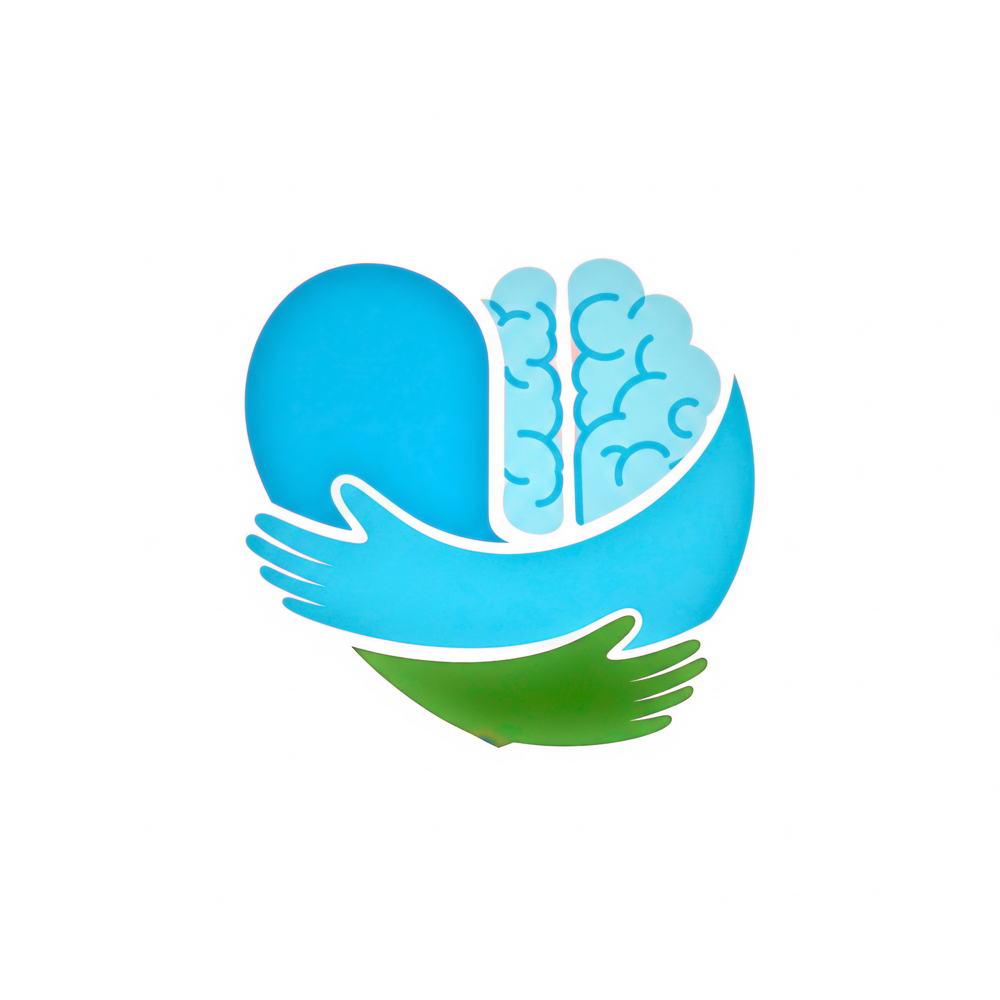

<p align="center">
  
</p>

<h1 align="center">Mentalp 🧘✨</h1>

<p align="center">
  Tu compañero diario para el bienestar emocional.
  <br>
  <br>
  
  
  
</p>

---

**Mentalp** es una aplicación móvil multiplataforma construida con Flutter y Firebase, diseñada como un santuario digital para el bienestar emocional. Su misión es ofrecer un espacio seguro y privado para el seguimiento del estado de ánimo, la reflexión personal guiada por IA y la conexión con una comunidad de apoyo.

## 🌟 Características Principales

*   **Registro de Ánimo Diario:** Registra tu estado de ánimo cada día y añade notas privadas para contextualizar tus emociones.
*   **Historial y Gráficas:** Visualiza la evolución de tu bienestar a lo largo del tiempo con gráficas interactivas para identificar patrones y progresos.
*   **Comunidad de Apoyo:** Un feed social seguro donde los usuarios pueden compartir pensamientos, imágenes y dar "me gusta" a las publicaciones de otros.
*   **Asistente Personal (Kai):** Chatea con un asistente de IA empático (potenciado por **Google Gemini Pro**) diseñado para escucharte y guiarte en tu reflexión personal.
*   **Biblioteca de Bienestar:** Una completa sección de recursos que incluye:
    *   **Charlas Inspiradoras:** Vídeos para motivar e informar.
    *   **Libros y Lecturas:** Recomendaciones de libros sobre salud mental.
    *   **Mindfulness:** Guías de meditación y ejercicios de respiración.
    *   **Nutrición Consciente:** Consejos y recetas para una alimentación saludable.
    *   **Sonidos Relajantes:** Paisajes sonoros para la meditación y la concentración.
    *   **Espiritualidad:** Contenido para la reflexión y el crecimiento personal.
*   **Gestión de Perfil Completa:** Los usuarios pueden cambiar su nombre, foto de perfil, correo electrónico y contraseña.
*   **Notificaciones y Recordatorios:** Sistema de notificaciones locales para recordar al usuario su registro diario.
*   **Seguridad Robusta:**
    *   Autenticación completa (email/contraseña, registro, recuperación).
    *   Reglas de seguridad estrictas en Firestore y Storage.
    *   Protección de API con **Firebase App Check** y Play Integrity.

## 🛠️ Stack Tecnológico

| Categoría                 | Tecnología                                                                                                  |
| :------------------------ | :---------------------------------------------------------------------------------------------------------- |
| **Framework Multiplataforma** | Flutter                                                                                                     |
| **Backend & Base de Datos** | Firebase (Authentication, Cloud Firestore, Storage, Cloud Functions)                                        |
| **Asistente IA**          | Google Gemini Pro vía Cloud Functions para Firebase (Python)                                                |
| **Seguridad**             | Firebase App Check (Play Integrity), Reglas de Seguridad                                                    |
| **Diseño y Estilo**       | `google_fonts`, `fl_chart`, `lottie`, `video_player`                                                        |
| **Gestión de Estado**     | `provider` (para el tema) y `StatefulWidget` (para estado local).                                           |
| **Notificaciones**        | `flutter_local_notifications`                                                                               |

## 📂 Estructura del Proyecto

El proyecto está organizado siguiendo una arquitectura limpia para asegurar que sea escalable, mantenible y fácil de navegar.

```
/
|-- android/            # Código nativo y configuración específica de Android.
|-- assets/             # Archivos estáticos: imágenes, animaciones Lottie, vídeos, fuentes y JSONs.
|-- functions/          # Backend serverless (Cloud Function en Python para la API de Gemini).
|-- ios/                # Código nativo y configuración específica de iOS.
|-- lib/                # ¡El corazón de la app! Todo el código Dart de Flutter vive aquí.
|   |-- auth/           # Lógica de autenticación, AuthGate y páginas de login/registro.
|   |-- models/         # Clases de modelo para estructurar los datos.
|   |-- screens/        # Cada una de las pantallas/vistas de la aplicación.
|   |-- services/       # Lógica de negocio (ej. NotificationService).
|   |-- theme/          # Tema visual de la app (colores, fuentes, estilos).
|   '-- widgets/        # Widgets reutilizables.
|-- test/               # Pruebas unitarias y de widgets.
|-- .firebaserc         # Configuración de los proyectos de Firebase.
|-- firebase.json       # Define qué partes de Firebase se despliegan.
|-- firestore.rules     # Reglas de seguridad para la base de datos Firestore.
|-- storage.rules       # Reglas de seguridad para el almacenamiento de archivos.
'-- pubspec.yaml        # Manifiesto del proyecto (dependencias, assets, etc.).
```

## 🚀 Cómo Empezar (Entorno de Desarrollo)

Para poner en marcha el proyecto en un entorno de desarrollo local:

1.  **Clonar el repositorio:**
    ```bash
    git clone https://github.com/tu-usuario/Mentalp.git
    cd Mentalp
    ```
2.  **Instalar dependencias de Flutter:**
    ```bash
    flutter pub get
    ```
3.  **Configurar Firebase:**
    *   Crea un proyecto en la Consola de Firebase.
    *   Activa **Authentication**, **Cloud Firestore**, **Storage**, **Cloud Functions** y **App Check**.
    *   Usa la Firebase CLI y ejecuta `flutterfire configure` para generar tu `firebase_options.dart`.
    *   Añade tu `google-services.json` (Android) en `android/app/` y `GoogleService-Info.plist` (iOS) en `ios/Runner/`.

4.  **Configurar Cloud Functions (Asistente Kai):**
    *   Navega a `functions/`, crea un entorno virtual (`python -m venv venv`), actívalo e instala las dependencias (`pip install -r requirements.txt`).
    *   Habilita la API de Google Gemini en Google Cloud y guarda tu API Key como un secreto en Secret Manager con el nombre `GEMINI_API_KEY`.
    *   Despliega la función: `firebase deploy --only functions`

5.  **Ejecutar la aplicación:**
    ```bash
    flutter run
    ```

---

*Este proyecto nace con la misión de ofrecer una herramienta accesible para el autoconocimiento y el fomento de una comunidad de apoyo en el ámbito de la salud mental.*